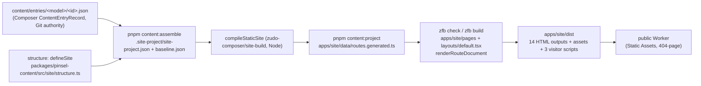

# Architecture

Pinsel has one canonical content source and two outputs: the public static site and the styleguide. Both render the same zudo-react components from `packages/pinsel-ui`, through one bridge, `renderRouteDocument`. Authoring is the native Composer workspace in `packages/pinsel-content` (`pnpm dev`, see [composer-adoption.md](composer-adoption.md)). Everything described here runs locally. Nothing is deployed (see "What is local-only" below).

## From content to pages



1. **Entries.** `content/entries/<model>/<id>.json` are the canonical records. Their values are keyed by field id. The models, the editable-field policy and the invariants are in `packages/pinsel-content` ([content-model.md](content-model.md)). The site structure (routes, compositions, mappings and collections) is code, `defineSite` in `src/site/structure.ts`. Editors cannot change it.
2. **Assemble.** `pnpm content:assemble` (`src/site/assemble.ts`) combines the entries and the structure into the derived, gitignored `.site-project/site-project.json`. It also writes `baseline.json`, which holds `baselineRevision` (the Git commit, or `$PINSEL_BASELINE_REVISION`) and `projectDigest`.
3. **Compile and project.** `pnpm content:project` (`src/site/project.ts`) runs Composer's Node `compileStaticSite`. It writes the resolved route documents as the ZFB data module `apps/site/data/routes.generated.ts` (`ROUTES`, `PROJECT_SOURCE_REVISION`) and the plan as `.site-project/plan.json`. The plan is pinned by `tests/golden/routes.snapshot.json` (`pnpm content:check`).
4. **Build.** `zfb build` renders every route through `apps/site/layouts/default.tsx` (`DocumentShell` from pinsel-ui) and `renderRouteDocument`. The result is complete static HTML with no adapter, no islands and no client router. The only scripts are the three visitor entries `apps/site/src/{art-clock,motion,site}.client.ts`, over the behaviours in `packages/pinsel-ui/src/scripts/`.
5. **Serve.** `apps/site/wrangler.jsonc` serves `dist/` as Workers Static Assets with `not_found_handling: "404-page"` and `auto-trailing-slash`, and has no `main`. Locally it runs under `pnpm site:wrangler-dev`.

## The `renderRouteDocument` bridge

`packages/pinsel-ui/src/render/render-route-document.ts`: `renderRouteDocument(route, registry)` walks `build.routes[].composition.document`, together with `linkedSource` and the materialised collections, and renders each node with the component from `pinselRegistry` (`src/pack.ts`, pack `pinsel@0.2.0`). A component's props are the manifest `defaults`, then the node `props`, then the injected `route`. Slots arrive as rendered children. Composer's generated `modules[].code` is never read. Two surfaces use this bridge, unchanged:

| Surface | Where it renders | How |
| --- | --- | --- |
| Public site | Node, `zfb build` | `ROUTES` from `routes.generated.ts` |
| Styleguide | zudo-sg story previews | stories in `packages/pinsel-ui/src/**`, copied as shims into `apps/styleguide/ui/` |

## CSS and the cascade layer order

The approved prototype CSS is split, byte-exact, into `packages/pinsel-ui/styles/tokens.css`, `colors.css` (both plain `:root` custom properties) and `components.css`. `components.css` declares the approved order:

```css
@layer tokens, reset, layout, components, responsive;
```

The `responsive` layer overrides tokens at 70rem, 47.99rem and 23rem, for example `--header-height`, `--gutter`, `--space-section` and `--space-8`. That only works if the token files sit inside `tokens`. Every surface therefore imports them into that layer:

| Surface | File | Token import |
| --- | --- | --- |
| Public site | `apps/site/styles/global.css` | `@import "…tokens.css" layer(tokens)` (and `colors.css`) |
| Styleguide preview | `apps/styleguide/src/styles/preview-entry.css` | nested as `pinsel.tokens < pinsel.reset < pinsel.layout < pinsel.components < pinsel.responsive`, so the Pinsel stack keeps its order next to zudo-wind's own `components` layer |

`pnpm check:token-layers` checks the built CSS. `tests/browser/token-layers.spec.ts` measures the resolved values on both surfaces at 1440, 1121, 1119, 769, 767 and 390px.

## Styleguide

`apps/styleguide` is a zudo-sg host. The stories live next to the components in `packages/pinsel-ui/src/**`. `scripts/gen-story-shims.mjs` copies them into `apps/styleguide/ui/`, and `zudo-sg gen-registry` and `gen-token-manifest` generate the registry and the token manifest. `pnpm sg:check` proves all three are current ([styleguide.md](styleguide.md)). The live token panel exists only here, never in the public output.

## Boundaries

| Boundary | Enforced by |
| --- | --- |
| The public dist has only allowlisted entries and the three visitor scripts. It has no Composer, SG, fixture, provenance, snapshot or editor material | `pnpm check:boundaries`, `scripts/publication/check-public-output.mjs` |
| Composer is installed only through the two git SHAs | `pnpm verify:external-install`, the lockfile specifiers |
| Nothing can deploy, promote or publish from scripts or workflows | `pnpm no-deploy:check` |
| The approved seed fixture and the approved assets are byte-exact | `pnpm check:approved-seed`, `pnpm assets:verify` |
| The strict migration checker always runs, and a skip fails | ci.yml jobs `migration-baseline` / `content-gate` |

## What is local-only

- **Public site.** `wrangler dev` serves it locally. `workers_dev` and `preview_urls` are off, and Workers Builds is not connected.
- **Contact.** The form validates and shows a local success panel. It has no `action` and sends nothing.
- **Indexing.** `apps/site/lib/site-config.ts` sets `indexing: "noindex"`. Every page carries `noindex,nofollow`, and `robots.txt` disallows everything.

The open launch decisions are in [launch-inputs.md](launch-inputs.md).
