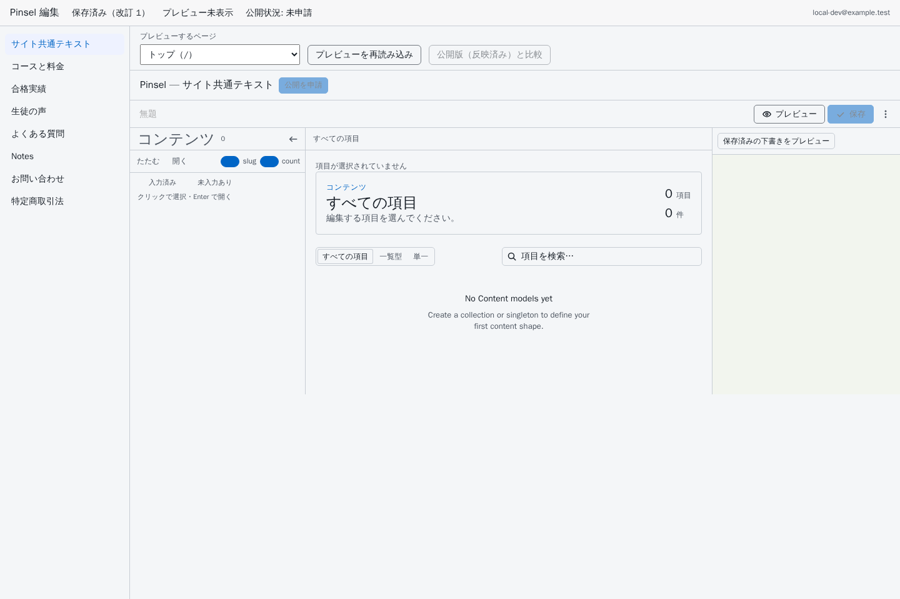
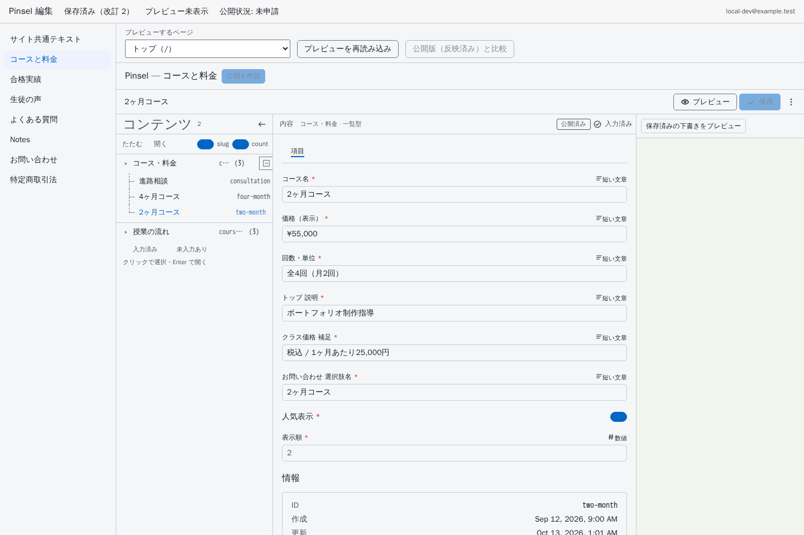
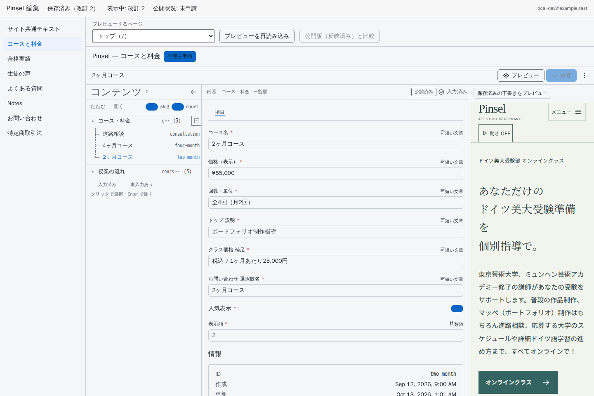
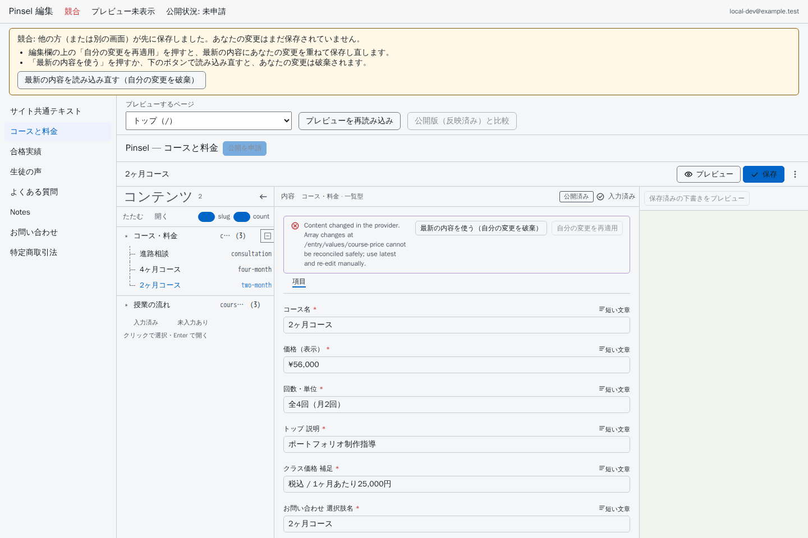
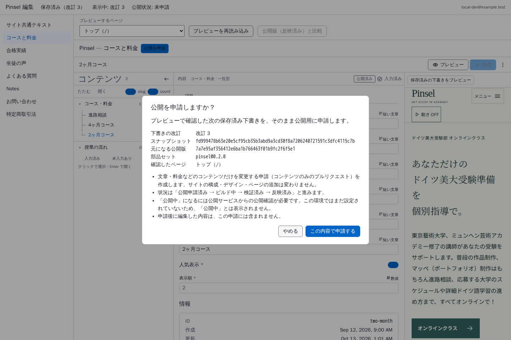
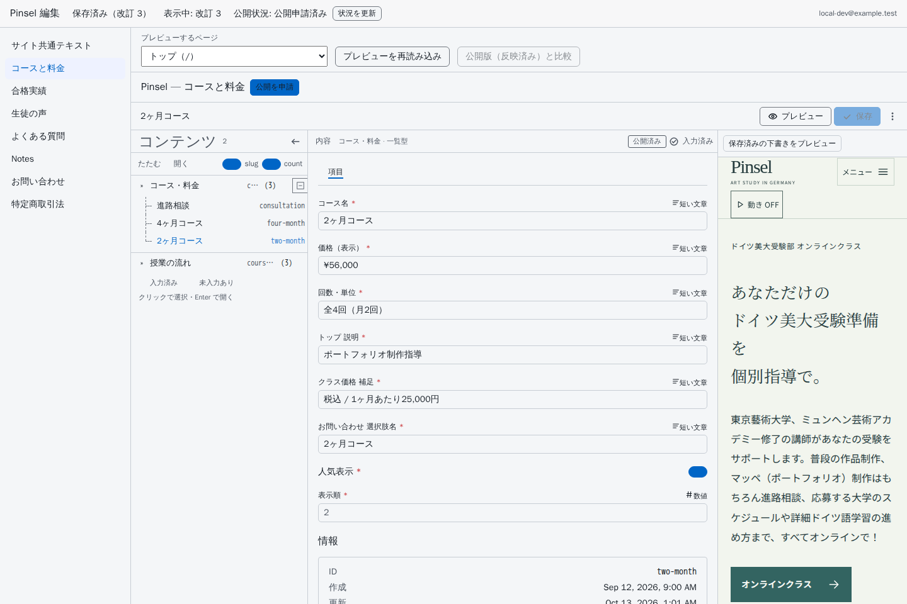

# サイトの文章・料金を編集する

**現在の状態：編集画面とログインはまだ公開・設置されていません。** 以下は、今後ホスト名や認証などの設定を完了した環境での操作ガイドです。現在はローカル検証のみで、標準の公開機能（`PUBLISHER_PROVIDER=disabled`）では実際の公開申請を送信できません。保存・検証・反映の完了は、本番サイトへの公開を意味しません。未確定の設定は [launch-inputs.md](launch-inputs.md) にまとめています。

設定が完了した環境では、Pinsel の文章や料金を編集画面から変更できます。この画面で変えられるのは「内容」だけです。ページの構成、デザイン、ページの追加・削除は変わりません。

## 1. 編集画面を開く

ブラウザで編集画面（`/editor/`）を開きます。初めて開くときはログイン画面が表示されるので、登録済みのメールアドレスでログインしてください。

画面上部の帯に、いまの状態がいつも表示されます。

| 表示 | 意味 |
| --- | --- |
| 未保存の変更 | 入力した内容がまだ保存されていません |
| 保存中 | 保存しています |
| 保存済み（改訂 n） | 保存が完了しました。n は保存のたびに 1 ずつ増える番号です |
| 競合 | 別の方（または別の画面）が先に保存しました。下の「4. 競合したとき」を見てください |
| 保存に失敗 | 保存できませんでした。表示されている理由を確認して、もう一度保存してください |

「保存済み」と表示されるのは、サーバーが保存を確認したときだけです。

## 2. 内容を選んで編集する

左の一覧から、編集したい内容の種類を選びます。

- サイト共通テキスト
- コースと料金
- 合格実績
- 生徒の声
- よくある質問
- Notes
- お問い合わせ
- 特定商取引法

項目を選んで入力欄を書き換えると、自動で保存されます。すぐに保存したいときは「保存」を押してください。URL や表示順など、灰色で変更できない欄は開発者が管理しています。

保存した内容は下書きです。まだ公開サイトには反映されていません。

## 3. プレビューで確認する

「保存済みの下書きをプレビュー」を押すと、右側に保存済みの下書きで作ったページが表示されます。「プレビューするページ」で確認するページを選べます。

| 表示 | 意味 |
| --- | --- |
| 読み込み中 | プレビューを作っています |
| 表示中: 改訂 n | 改訂 n の下書きがそのまま表示されています |
| 古いプレビュー | プレビューの後に内容が変わりました。もう一度プレビューしてください |

プレビューが表示されないときは「プレビューを再読み込み」を押してください。「公開版（反映済み）と比較」を押すと、いま公開用に反映されている内容と並べて確認できます。

## 4. 競合したとき

同じ内容を別の方が先に保存すると「競合」と表示され、あなたの変更はまだ保存されていません。次のどちらかを選んでください。

- **自分の変更を再適用**: 最新の内容に、あなたの変更を重ねて保存し直します。
- **最新の内容を使う**: 最新の内容を読み込みます。あなたの変更は破棄されます。

## 5. 公開を申請する

保存して、プレビューで「表示中」になった内容だけを公開申請できます。「公開を申請」を押すと確認画面が開き、申請する下書きの改訂番号とスナップショット（内容を特定する番号）が表示されます。内容を確認して「この内容で申請する」を押してください。

公開機能を設定した環境で申請すると、内容だけを変更する申請（コンテンツのみのプルリクエスト）が作られます。申請後の状況は画面上部の「公開状況」に表示されます。「状況を更新」で最新の状況を確認できます。

| 公開状況 | 意味 |
| --- | --- |
| 下書き保存済み | 下書きは保存されていますが、まだ申請していません |
| 公開申請済み | 申請を受け付けました |
| ビルド中 | サイトを作っています |
| 検証済み | 作ったサイトの確認が終わりました |
| 反映済み | 公開用のサイトに反映されました |
| 公開中 | 公開サービスが公開を確認しました |
| 失敗 | 途中で失敗しました。開発者に連絡してください |
| 公開内容の競合 | 申請の間に公開内容が別に変わりました。もう一度編集して申請してください |
| 設定が必要 | 公開の設定がまだ完了していません。開発者に連絡してください |

「公開中」と表示されるのは、公開サービスから公開の確認が届いたときだけです。現在は公開機能自体が無効なので、実際の申請はできません。ローカルの検証では「反映済み」まで確認していますが、本番への公開を証明するものではありません。

## 困ったとき

- 「ログインが必要です」と表示されたら、ページを開き直してログインしてください。
- 「このアカウントには編集の権限がありません」と表示されたら、管理者に連絡してください。
- 「利用できません」と表示されたら、編集画面（`/editor/`）を開き直してください。この画面ではコンテンツの編集だけができます。
