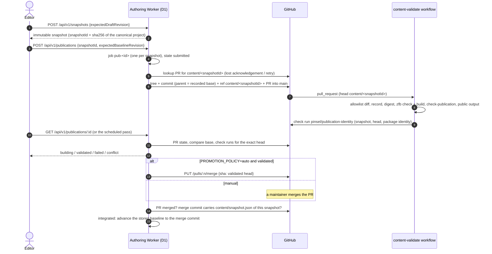

# Publication pipeline

How a saved draft becomes integrated content. Everything here is implemented and tested against the fake provider and recorded GitHub responses. Nothing is connected: publication is off (`PUBLISHER_PROVIDER=disabled`), no GitHub token exists, no cron trigger is configured, and Cloudflare Workers Builds is not connected to the repository. The launch inputs are at the end.

Code: `apps/authoring-worker/src/publish/` — `port.ts` (provider port, evidence guard), `jobs.ts` (jobs in D1), `reconcile.ts` (reconciliation loop), `github-provider.ts` (GitHub REST adapter), `snapshot-files.ts` + `publication-record.ts` (what is written to Git and reported by CI), `fake-provider.ts` (tests and `wrangler dev --env local`). CI: `.github/workflows/content-validate.yml`, the `publication-validate` job of `.github/workflows/ci.yml`, `scripts/publication/*.mjs`.

## Sequence

## States

`state` in every `/api/v1/publications` response. The Japanese label is the editor's (simple) wording; the evidence column is what the Worker requires before reporting the state.

| API state | Label | Evidence required |
| --- | --- | --- |
| `draft-saved` | 下書き保存済み | A draft revision in D1. Never stored on a job; saving never publishes. |
| `submitted` | 送信済み | The provider acknowledged the submission (GitHub: branch `content/<snapshotId>` and an open PR whose head is the commit the Worker wrote). |
| `building` | 確認中 | Checks started, are pending, or passed without a matching identity report. Also the fallback whenever a stronger claim lacks proof. |
| `validated` | 確認済み | Every required check run (default `content-validate`) **for the exact head commit** concluded `success`, and the `pinsel/publication-identity` check run from the `github-actions` app names this snapshot id, content digest, head commit and package identity. |
| `integrated` | 反映済み（公開前） | The PR is merged and its merge commit carries this snapshot's `content/snapshot.json`. The stored baseline then advances to that commit. |
| `live` | 公開中 | Deployment evidence for the same commit. No provider produces it in this scope (no Cloudflare build is connected), so it is never reported. |
| `failed` | 失敗 | A required check failed (or was skipped/cancelled), the PR was closed without merging, or the provider refused the submission. The draft and the live baseline are untouched. |
| `conflict` | 競合 | The content branch head moved (someone pushed), `main` changed `content/**` since the recorded base, the stored baseline moved while the job was in flight, the PR was retargeted, or CI validated a different snapshot / head / package identity. |
| `configuration-required` | 設定が必要 | `PUBLISHER_PROVIDER` is `disabled` (the default), unknown, or missing its inputs. Reported with `lastObservedState` for existing jobs. |

Timeouts and unavailable answers never change the state: `providerFailures` counts consecutive ones and `message` says what happened. `reconcileAttempts` counts observations, `attempts` counts submissions (lookups included).

## Invariants

- **One job per snapshot.** `pub-<first 32 hex of snapshotId>`, also the idempotency key. A duplicate or concurrent request returns the same job.
- **No second submission after a lost acknowledgement.** After the first attempt the Worker asks the provider first (`lookupExisting`): GitHub finds the open or merged PR for `content/<snapshotId>` and reuses it only if the head carries the same `content/snapshot.json`.
- **Serialized reconciliation.** A pass claims a per-job lease (`jobs.lease_token`, conditional UPDATE, read back); a concurrent pass returns the stored job with `reconciling: true` and never calls the provider. Every state write is a compare-and-set on `jobs.version`.
- **Content-only commits.** The GitHub provider writes through the Git Data API: one tree on the recorded base's tree with only changed `content/entries/<model>/<id>.json` files (rewritten in the key order of the file they replace, so a price edit is a one-line diff), deletions of removed entries, and `content/snapshot.json`. The commit's only parent is the recorded base. Every path is checked against `PINSEL_PUBLISH_ALLOWLIST` / `isPublishablePath` from `@pinsel/content`; CI checks the PR diff against the same function.
- **Baseline advance from verified evidence only.** After `integrated` the loop calls the storage advance (`advanceFromPublication`) with the merge commit the provider re-read, never a caller-supplied sha. A clean draft becomes clean at the new baseline; an edit made while the publication was building is kept as the draft on the new baseline.
- **Integrated preview.** `GET /api/v1/site` reports `baselinePreview: { snapshotId, revision }`, an immutable snapshot of the stored baseline (created on first read after each seed, advance or rebase, never deleted), rendered by `/preview/<snapshotId>/<route>?revision=<revision>` next to the draft. It is content-addressed, so after an advance it is the published snapshot itself.
- **External changes are conflicts, not overwrites.** A canonical change made outside the CMS is reconciled through `POST /api/v1/baseline/reconcile` (detect → `conflictId` → repeat with `{conflictId, expectedDraftRevision, prefer?}`), which three-way rebases the draft or lists field conflicts. The in-flight job becomes `conflict`; the next snapshot is taken on the new baseline. This is the rebase path the sub-issue calls `POST /drafts/:id/rebase`.

## Recovery policy

- `failed` is recoverable: requesting the same snapshot again re-arms the same job (state `submitted`, same key) if the base has not moved. The provider reuses the branch and opens a new PR only if the old one was closed. For a failed check, re-run the workflow on GitHub first, then request again.
- `conflict` is final for that snapshot: the base or the provider's copy changed. Reconcile the baseline if needed and publish a new snapshot.
- A provider timeout during submission leaves the job `submitted` without a provider reference and returns `uncertain` (503). `GET /api/v1/publications/:id` or a repeated `POST` recovers it by lookup.

## What the CI validates

`content-validate.yml` runs on `pull_request` into `main` (the target filter) and only for heads named `content/*` (job-level `if: startsWith(github.head_ref, 'content/')`). It checks out the exact head commit and runs, in order:

1. `pnpm install --frozen-lockfile`, `pnpm no-deploy:check`.
2. `check-snapshot.mjs paths`: `git diff base...head` ⊆ `content/entries/**` + `content/snapshot.json`, and the record is part of the change.
3. `check-snapshot.mjs record --head`: `content/snapshot.json` is a strict record (`snapshotId`, `baselineGitSha`, `contentDigest`, `packageIdentity {zfb, composerSha, contractSha}`, `requestedBy`, `requestedAt`); the package identity equals this checkout's pins (authoring Worker `package.json`, and the site's zfb agrees); the head commit's only parent is `baselineGitSha`.
4. `pnpm assets:sync`, `pnpm content:validate`, `pnpm content:assemble`.
5. `check-snapshot.mjs digest`: the project assembled from the committed entries hashes to the snapshot id, i.e. the files are exactly that snapshot.
6. `pnpm content:project`, `zfb check`, `zfb build`.
7. `scripts/content/check-publication.mjs --dist apps/site/dist`: routes, fragments, art windows, assets, metadata policy and protected fields for the submitted content.
8. `check-public-output.mjs`: no repository-only material in the public build.
9. Only after all of that: a `pinsel/publication-identity` check run for the head commit whose summary carries the machine-readable identity report. The provider requires it, from the `github-actions` app, before `validated`.

No step deploys, merges or promotes.

**Migration fixture split.** The historical strict checker (`scripts/check-content.sh`, the immutable 14-page seed fixture) runs only in ci.yml's `migration-baseline` job, which runs only while there is no `content/snapshot.json`. Once content has been published, ci.yml runs `publication-validate` instead: the record, `check-publication` against the committed entries and the public output check. The fixture itself is never edited or weakened, and a legitimate price edit passes the snapshot checks without touching it.

## Promotion policy

- `PROMOTION_POLICY=manual` (default): the PR waits for a maintainer. The Worker reports `validated` and then `integrated` once the merge commit is observed.
- `PROMOTION_POLICY=auto`: when a pass observes `validated`, the provider re-reads the PR and checks immediately before merging, then calls `PUT /pulls/:n/merge` with `sha` = the validated head and `merge_method: merge`. GitHub refuses if the head moved (409 → `conflict`) or branch rules are not met (405/422 → stays `validated`, message `Promotion refused: …`). Integration is then whatever the next observation proves, never the merge answer itself. Editors never need GitHub in this mode. Branch rules are honoured, never bypassed: the token needs no admin rights.

## Configuration

| Variable | Kind | Default | Meaning |
| --- | --- | --- | --- |
| `PUBLISHER_PROVIDER` | var | `disabled` | `github` activates the GitHub provider (also needs the two inputs below). `fake` exists only in `wrangler dev --env local`. |
| `PUBLISHER_GITHUB_REPOSITORY` | var | — | `owner/repo` of the canonical content repository. |
| `PUBLISHER_GITHUB_TOKEN` | **secret** | — | Fine-grained token or GitHub App installation token: `contents: write`, `pull_requests: write`, `checks: read` on that repository only. Never in `wrangler.jsonc`, never in the browser. |
| `PUBLISHER_GITHUB_BASE_BRANCH` | var | `main` | Branch content PRs target. |
| `PUBLISHER_GITHUB_REQUIRED_CHECKS` | var | `content-validate` | Comma-separated check run names that must pass for the head commit, in addition to `pinsel/publication-identity`. |
| `PROMOTION_POLICY` | var | `manual` | `manual` or `auto`; anything else is `configuration-required`. |
| `PUBLICATION_RECONCILE_SCHEDULE` | var | unset (= off) | `enabled` lets the `scheduled()` handler reconcile open jobs. It also needs a `triggers.crons` entry in `wrangler.jsonc`, which is not configured. |

The new variables are read defensively from the environment and are not declared in `wrangler.jsonc`; declaring them belongs to the launch change. `content/snapshot.json` records `requestedBy` (the Access subject, an e-mail address) in the repository history.

## Launch inputs (not done)

- Publisher identity: a GitHub App or a fine-grained token with the scopes above, stored as the `PUBLISHER_GITHUB_TOKEN` Worker secret; `PUBLISHER_GITHUB_REPOSITORY`; then `PUBLISHER_PROVIDER=github`.
- Branch protection on `main` (recommended, not applied): require the `content-validate` and `pinsel/publication-identity` checks and the CI `build` job, require branches to be up to date before merging, restrict who can push to `content/*` (only the publisher identity), and keep force pushes and deletions disabled.
- Promotion policy: `manual` or `auto`.
- Scheduled reconciliation: a cron trigger plus `PUBLICATION_RECONCILE_SCHEDULE=enabled` (otherwise status advances only when the editor reads it).
- Cloudflare build/deployment connection: Workers Builds stays **unconnected**. Once connected, a provider that observes the deployment for the merge commit can report `deployed` (`DeploymentEvidence {deploymentId, commit, observedAt}`) and only then does a job become `live`.

## Verification in this scope

- Worker tests (`pnpm --filter @pinsel/authoring-worker test`, workerd + local D1): `test/publication-scenarios.test.ts` covers the sub-issue scenarios (a)–(f) and (h)–(k) plus auto promotion and the scheduled pass; `test/github-provider.test.ts` covers the adapter against recorded responses (`test/fixtures/github/`, replayed by `test/github-replay.ts`, which fails any unrecorded request); `test/publication-files.test.ts` proves the entry writer reproduces every committed entry file byte for byte.
- Scenario (g), a price edit passing `check-publication` with the migration fixture untouched, is a local dry run of the CI steps on a sample snapshot (recorded in the sub-issue).
- `scripts/publication/check-snapshot.test.mjs` covers the CI checks. Workflows are linted with `actionlint`.
